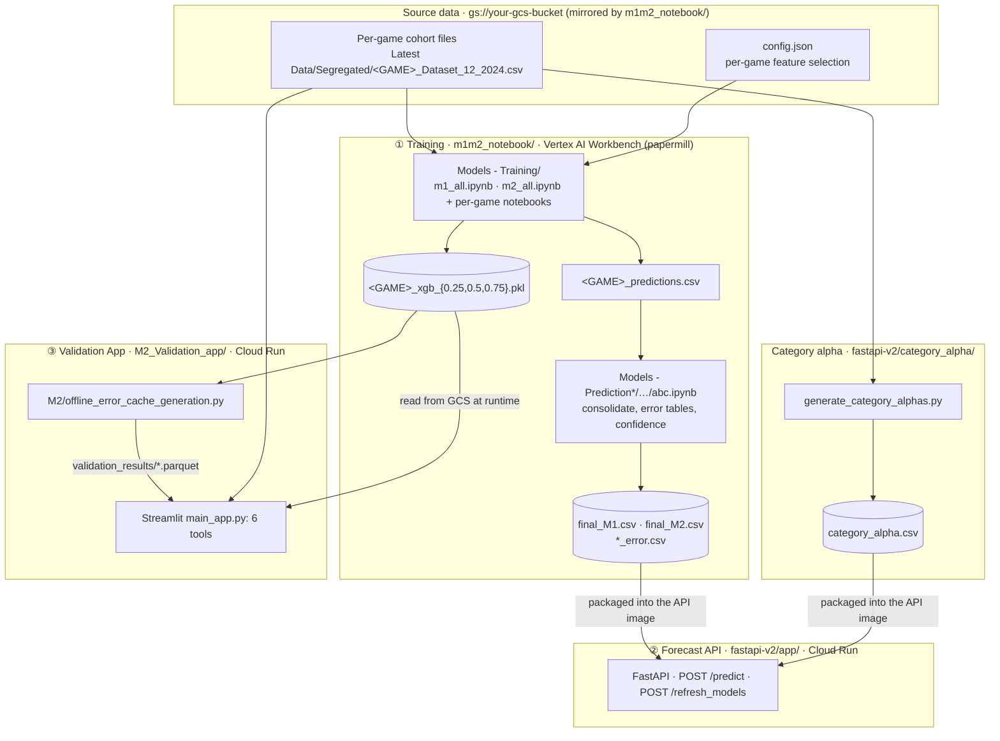
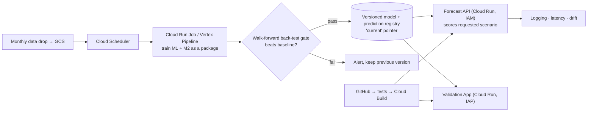

# v1 Technical Overview: Cohort ROAS Forecasting Platform (production, 2025)

This document is the technical reference for the production system in `v1/`, written for a technical reviewer.
It covers the flow end to end, the data contract, the models, how accuracy is measured, the Validation App,
the Google Cloud deployment, and the architecture outlook.

> **View-only.** v1 ran against client data and Google Cloud resources that are not part of this repository.
> It is shared for code review and cannot be run as-is. The runnable sample is [`../v2`](../v2).

## Contents

1. [What the system does](#1-what-the-system-does)
2. [End-to-end flow](#2-end-to-end-flow)
3. [Repository map](#3-repository-map)
4. [Data contract](#4-data-contract)
5. [Training pipeline (M1 and M2)](#5-training-pipeline-m1-and-m2)
6. [Spend scaling and category alpha](#6-spend-scaling-and-category-alpha)
7. [Accuracy metrics and validation method](#7-accuracy-metrics-and-validation-method)
8. [Validation App (M1/M2 Analytics Suite)](#8-validation-app-m1m2-analytics-suite)
9. [Forecast API](#9-forecast-api)
10. [Production deployment on Google Cloud](#10-production-deployment-on-google-cloud)
11. [Operations: the monthly refresh](#11-operations-the-monthly-refresh)
12. [Architecture outlook](#12-architecture-outlook)
13. [Review notes: fixes applied after deployment and known limitations](#13-review-notes)

---

## 1. What the system does

The client, a growth-capital provider, funds user-acquisition (UA) spend for about 50 mobile games and is repaid
from the revenue those cohorts earn. For every funding decision it needs:

| Question | Answer the platform gives |
|---|---|
| What will a cohort acquired in month M with spend $X return, month by month? | Monthly **incremental net ROAS** (net revenue ÷ CAC), cumulative ROAS and absolute revenue |
| What is the realistic downside / upside? | **Bad / expected / good** paths from quantile models (0.25 / 0.50 / 0.75) |
| What if spend is scaled up or down? | A diminishing-returns adjustment based on a category-level decay coefficient α |
| How much should we trust the forecast for this game? | Back-test error tables per game, per case and per month, plus a confidence score per cohort |

Everything is per game, because games differ strongly in curve shape and monetisation mix (in-app ads vs
in-app purchases).

## 2. End-to-end flow



The design is **batch scoring**. Forecasts are computed offline by the training notebooks. The consolidated
prediction store (`final_M2.csv`) is packaged with the API, so the API never loads an ML model while
answering a request. That gives low latency, no library-version coupling between training and serving, and a
small container. The trade-off is that a request is answered from a reference cohort's precomputed curve and
adjusted, rather than scored fresh (see §9 and §13).

## 3. Repository map

| Stage | Folder | Key files |
|---|---|---|
| ① Training | `m1m2_notebook/Models - Training/` | `m1_all.ipynb`, `m2_all.ipynb` (batch, loop over games); `<GAME>_m1_predictions_quantile_reg.ipynb`, `<GAME>_m2_predictions_3_variations.ipynb` (per game); `m2.ipynb`, `m2_net_rev.ipynb`, `net_rev+arppu.ipynb` (target variants); `experiment/` (seasonal vs non-seasonal study for one game); `config.json`, `config1.json`, `config_4.json` |
| ① Consolidation | `m1m2_notebook/Models - Prediction/…`, `Models - Prediction-m1/…` | `abc.ipynb` (consolidate + metrics), `m1.ipynb` / `m2.ipynb` (append new months), `modify.ipynb`, `adding_*.ipynb`, `data_check.ipynb` (one-off corrections) |
| α Category alpha | `fastapi-v2/category_alpha/` | `generate_category_alphas.py` (production output), `generate_category_alphas_extended.py` (variants), `G001_*` (projection experiments) |
| ② Serving | `fastapi-v2/app/` | `main.py`, `inference.py`, `schemas.py`, `find_latest_cohort.py`, `Dockerfile`, `requirements.txt` |
| ③ Validation | `M2_Validation_app/` | `main_app.py` (router), six tool modules, `m1_validation_helper.py`, `cache_helper.py`, `M2/` (modular M2 training framework and offline cache generator), `Dockerfile`, `deploy.sh` |

## 4. Data contract

**Per-game cohort history:** `Latest Data/Segregated/<GAME_ID>_Dataset_12_2024.csv`, one row per **cohort ×
transaction month**.

| Group | Columns |
|---|---|
| Keys | `game_id`, `client_id`, `cohort` (dd/mm/yyyy), `transaction_period` (dd/mm/yyyy), `elapsed_months` (1 = acquisition month) |
| Spend | `total_cac`, `client_actual_spend` (back-fill each other), `MC_<channel>` per ad channel (`MC_Google`, `MC_Facebook`, `MC_Applovin`, `MC_Moloco`, `MC_Unity`, `MC_Ironsource`, `MC_Tiktok`, `MC_Organic`, …) |
| Early signals | `day_{1,7,14,30}_payer_retention`, `day_{1,7,14,30}_net_revenue_retention`, `day_{1,7,14,30}_cumulative_ltv_cac`, `m0_ltv_cac`, `total_users` |
| Monthly activity | `users`, `transactions`, `gross_revenue`, `net_revenue`, `avg_*_revenue`, `cumulative_*_revenue`, `user_retention`, `revenue_retention`, `cohort_users`, `cohort_*_revenue` |
| **Target** | `transaction_period_ltv_cac` (incremental net ROAS for the month), `cumulative_ltv_cac` |
| Financing (excluded from modelling) | `principal`, `interest`, `adjustment`, `adjustment_interest`, `total_pvx_share` |
| Audit | `created_date`, `updated_date` |

**Prediction store:** `final_M2.csv` (and `final_M1.csv`), read by the API and the Validation App.

| Column group | Meaning |
|---|---|
| `incremental_net_roas`, `cumulative_net_roas`, `net_revenue`, `total_cac` | Actuals where realised |
| `{incremental_net_roas,cumulative_net_roas,net_revenue}_{bad,expected,good}[_pred]` | Quantile forecasts (0.25 / 0.50 / 0.75) |
| `cumulative_net_roas_{bad,expected,good}_wa` | "With actuals": the actual cumulative ROAS where realised, the forecast after |
| `scaled_confidence_score`, `confidence_category` | Per-cohort confidence (see §7.4) |

**Extrapolation helpers:** `game_metrics_output.csv` (`game_id, IAA_pct, IAP_pct, Category, Genre`),
`category_averages_output.csv` (`Category, IAA_pct, IAP_pct`), `category_alpha.csv`
(`category, category_alpha, games_count, games_list`).

## 5. Training pipeline (M1 and M2)

### 5.1 Preprocessing (per game)
1. Parse `cohort` and `transaction_period` as day-first dates. Reconcile `total_cac` with `client_actual_spend`,
   and drop rows with no spend.
2. Keep cohorts from 2023 onward (the current market regime). Keep transactions **before the current month**,
   so a partially realised month is never used as a label.
3. Derive `cohort_month`, `current_month` (calendar month of the transaction) and ROAS lags `ltv_lag_1..3` within
   each cohort.

### 5.2 Two model families

| | M1: spend-driven | M2: history-driven |
|---|---|---|
| Use | New or planned cohorts with little or no observed history | Live cohorts with observed months |
| Features | `total_cac`, channel spend `MC_*`, `cohort_month`, `current_month`, lags 1–3 | M1 features + early retention / LTV signals, activity, `elapsed_months` (selected per game) |
| Notebooks | `<GAME>_m1_predictions_quantile_reg.ipynb`, `m1_all.ipynb` | `<GAME>_m2_predictions_3_variations.ipynb`, `m2_all.ipynb` |

### 5.3 Feature selection (M2, automated, stored in `config.json`)
1. Drop low-variance numeric features (`VarianceThreshold`, 0.01).
2. Drop one feature from each highly correlated pair (Pearson |r| > 0.85).
3. Fit a base XGBoost model and keep features with importance > 0.
4. Force back domain-critical features (`elapsed_months`, `total_cac`, lags) if removed.

The selected list per game and model (`M1_<GAME>`, `M2_<GAME>`) is written to `config.json`, so training and
the Validation App use the same features.

### 5.4 Quantile models
For each game, three XGBoost regressors are trained with a pinball (quantile) loss at τ = 0.25, 0.50, 0.75:

```
L_τ(y, ŷ) = max( τ·(y − ŷ), (τ − 1)·(y − ŷ) )
```

Each sits in a scikit-learn `Pipeline` (`StandardScaler` on numeric columns + `XGBRegressor`). The
hyper-parameters (`n_estimators`, `max_depth`, `learning_rate`, `subsample`, `colsample_bytree`, `gamma`,
`reg_alpha`, `reg_lambda`, `min_child_weight`) are tuned with `RandomizedSearchCV` (100 iterations). The search
uses `TimeSeriesSplit(5)` scored on pinball loss, after a **time-based** 80/20 split: train on earlier transaction
months, test on the most recent 20% (see §13 for why this changed). Models are saved with `cloudpickle` as
`<GAME>_xgb_<τ>.pkl`.

The modular framework in `M2_Validation_app/M2/` can also train random forest, LightGBM, CatBoost and ridge
models through one `ModelFactory`. It compares them on holdout RMSE (with a 6-month holdout by elapsed month when
a game has at least 8 months of history) and reports a per-game RMSE heatmap. It powers the M2 training tool.

### 5.5 Recursive forecasting
Forecasts are produced one month at a time. Each predicted month is fed back as the next month's lag, and the
calendar features advance with the date. The bad, expected and good paths each keep their own lags. Cumulative
ROAS is the running sum, and revenue = ROAS × CAC.

### 5.6 Consolidation (`abc.ipynb`)
Per-game prediction CSVs are merged into `final_M1.csv` / `final_M2.csv`, with actuals, the three quantile
paths, cumulative columns, the "with actuals" columns, and the confidence score (§7.4). The same notebook writes the
four error tables (`absolute_/percentage_` × `incremental_/cumulative_error.csv`).

## 6. Spend scaling and category alpha

Tree models cannot extrapolate beyond the spend levels they were trained on, so the API adjusts the reference
cohort's forecast when the requested spend differs:

```
ROAS_new(m) = ROAS_base(m) / (1 + α′ · γ · β · Δs),     Δs = (CAC_new − CAC_base) / CAC_base
```

| Term | Definition in code |
|---|---|
| α (category) | `generate_category_alphas.py`: for each game, take the 5 highest-spend month-1 cohorts. For consecutive pairs, α = (ROAS_base/ROAS_new − 1) / Δspend. Keep positive values, drop values above 3× the median, average them, then aggregate by category. |
| α′ (game) | α_category × (IAA·(1 + ΔIAA) + IAP·(1 + ΔIAP)), adjusting for how the game's ad / in-app-purchase revenue mix differs from its category average; default 0.05 if unavailable |
| γ | Spend tier: 1.0 below $300k, 1.4 up to $1M, 1.7 above |
| β | 1 + Σ w_c · share_c, with w = 0.6 for organic and 1.0 otherwise; falls back to 1.0 if undefined |

Safeguards: NaN or division errors fall back to a direction-preserving factor, and implausible base predictions
(> 10) are zeroed for the one special-cased game.

## 7. Accuracy metrics and validation method

### 7.1 Error definitions (`calculate_error` / `calculate_cumulative_error`)
For a cohort, month *m*, actual *a* and forecast *f* (expected path unless stated):

| Metric | Formula | Notes |
|---|---|---|
| **Absolute incremental error** | \|f_m − a_m\| | In ROAS units (e.g. 0.02 = 2 cents per $ of CAC) |
| **Percentage incremental error** | \|f_m − a_m\| / \|a_m\| × 100 | Undefined (NaN) when a_m = 0 |
| **Absolute cumulative error** | \|Σ_{k≤m} f_k − Σ_{k≤m} a_k\| | What drives repayment risk |
| **Percentage cumulative error** | \|Σf − Σa\| / \|Σa\| × 100 | |

NaN actuals or predictions are excluded from every average.

### 7.2 Cases (forecast vantage points)
- **M1 validation:** *case k* takes as its base the (13 − k)-th most recent cohort with a full 12 months (when 12
  such cohorts exist): case 1 is the oldest vantage point, case 6 the 7th most recent. That base cohort's realised curve
  is extrapolated to every later cohort with the §6 factor, and each row records its `predicted_on` date.
- **M2 validation (offline cache):** *case k* conditions on the first **k** observed months of a cohort, then
  forecasts the remaining months recursively, over the latest 12 cohorts. Case 1 therefore scores M2 onward.

### 7.3 Tables reported
- Per game and cohort: actual vs bad/expected/good curves; incremental and cumulative error by month
- **Overall average** and **rolling average** error tables per game (incremental and cumulative)
- Case-1 average error by game × month (M2–M12)
- M3 / M6 / M9 / M12 errors for all cases by game
- Portfolio views: game × month average errors, case-wise averages, overall statistics
- The M1 forecasting tool also reports transactional and cumulative error statistics in % and absolute terms,
  plus RMSPE when comparing model types

### 7.4 Confidence score (per cohort, in the prediction store)
1. RMSE of the expected path vs actuals, for the game (`model_rmse`) and for each cohort (`cohort_rmse`)
2. `confidence_trend = (model_rmse − cohort_rmse) / model_rmse`; `abs_conf = |confidence_trend|`
3. Min–max scale `abs_conf` within each game, giving `scaled_confidence_score` ∈ [0, 1]
4. Category: ≤ 0.33 **High**, ≤ 0.67 **Moderate**, else **Low**

### 7.5 How to read these numbers
The case tables are produced with the production models, which were trained on all available history. They
measure **fit by vantage point**, not out-of-sample accuracy (§13). No naive baseline is reported alongside
them. Client accuracy figures are not reproduced here.

## 8. Validation App (M1/M2 Analytics Suite)

**Entry point:** `main_app.py`, one Streamlit app with a sidebar to choose the model family and tool.

| Suite | Tool | Module | Data source |
|---|---|---|---|
| M1 | Model Validation | `M1_Validation_app.py` + `m1_validation_helper.py` | Per-game cohort CSVs in GCS; cases computed on the fly |
| M1 | 6-Month Forecasting | `forecast_tool_4.py` | Cohort CSVs + helper tables (alpha, game metrics) |
| M1 | Underlying Table | `m1_underlying_table.py` | All cases × cohorts × months, exportable |
| M2 | Model Validation | `M2_Validation_app_gcs_only.py` | `gs://your-gcs-bucket/validation_results/metadata.json` + `games/<GAME>_complete.parquet` |
| M2 | 6-Month Forecasting | `forecast_tool_m2.py` | Models in GCS (fallback loader `model_fix_utils.py`) |
| M2 | Underlying Table | `underlying_table.py` | Validation cache, exportable |

**Precomputed cache.** `M2/offline_error_cache_generation.py` loads each game's selected model and runs the
case predictions for all three error "themes". It writes one Parquet per game plus a `metadata.json` (games,
schema, generation time), which are uploaded to `validation_results/`. The app reads only this cache, so pages load
fast and every user sees the same numbers. `cache_helper.py` handles cached GCS reads. `test_gcs_data.py` and
`test_m1_multi_case.py` check cache access and the M1 case logic.

**Container.** `python:3.12-slim` with build tools for CatBoost and LightGBM, `PYTHONPATH=/app`, Streamlit on
port 8080. XSRF protection is on. GCS access uses the Cloud Run service account; no keys are stored in the image.

## 9. Forecast API

| Item | Detail |
|---|---|
| Endpoint | `POST /predict`: body `{"requests": [...]}`, max 50 requests per call |
| Request | `game_id`, `cohort_month` (`YYYY-MM`), `forecast_months` (1–60), `use_market_channels`, `total_cac` and/or `channel_spends` (8 channels; unknown channels → HTTP 400) |
| Response | Per month: `transactional_expected`, `cumulative_expected`, `absolute_revenue_expected`, plus `runtime_seconds` |
| Logic | Find the game's latest cohort with spend. Take its forecast curve from `final_M2.csv` (month 1 uses the realised value, months ≥ 2 the expected prediction). Apply the §6 factor for the requested spend. When no channel split is given, use the channel mix of the nearest historical cohort. |
| Admin | `POST /refresh_models`: reloads `final_M2.csv` and the helper tables from disk without a restart |
| Errors | Validation problems → 400 with the reason; unexpected → 500 |
| Container | `python:3.12-slim`, `uvicorn main:app` on 8080; data files packaged in the image |

## 10. Production deployment on Google Cloud

| Component | Configuration |
|---|---|
| Region | `asia-southeast1` |
| Images | Artifact Registry `asia-southeast1-docker.pkg.dev/<project>/<repo>/<image>` |
| Validation App | Cloud Run `m2-validation-app`: 2 vCPU, 2 GiB, concurrency 10, max 20 instances, VPC egress `private-ranges-only` on the client network/subnet, **authenticated access only** |
| Forecast API | Cloud Run service from `fastapi-v2/app/Dockerfile`, port 8080, **authenticated access only** |
| Storage | `gs://your-gcs-bucket`: mirrors `m1m2_notebook/` (data, models, prediction store, `validation_results/`) |
| Training | Vertex AI Workbench (Jupyter), notebooks executed headless with papermill |
| Identity | Cloud Run service account with read access to the bucket; callers need `roles/run.invoker` (or IAP for the app) |

Deploying the Validation App (`M2_Validation_app/deploy.sh`):

```bash
gcloud auth login && gcloud config set project <project>
gcloud auth configure-docker asia-southeast1-docker.pkg.dev
docker build --no-cache -t asia-southeast1-docker.pkg.dev/<project>/m2-validation-app-repo/m2-validation-app .
docker push  asia-southeast1-docker.pkg.dev/<project>/m2-validation-app-repo/m2-validation-app
gcloud run deploy m2-validation-app --image <image> --region asia-southeast1 --no-allow-unauthenticated \
  --cpu=2 --memory=2Gi --concurrency=10 --max-instances=20 --vpc-egress=private-ranges-only \
  --network=<vpc> --subnet=<subnet>
```

The API is deployed the same way from `fastapi-v2/app/` (build → push → `gcloud run deploy … --no-allow-unauthenticated`).

## 11. Operations: the monthly refresh

1. Land the new month's cohort files in `gs://your-gcs-bucket/Models - Training/Latest Data/Segregated/`.
2. Run `m1_all.ipynb` and `m2_all.ipynb` with papermill on Vertex AI Workbench: models + per-game predictions.
3. Run the consolidation notebooks (`abc.ipynb`): `final_M1.csv`, `final_M2.csv`, error tables, confidence.
4. Run `M2/offline_error_cache_generation.py` and upload `validation_results/`. The Validation App picks it up.
5. If categories or history changed, run `fastapi-v2/category_alpha/generate_category_alphas.py`.
6. Copy `final_M2.csv` and the helper CSVs into `fastapi-v2/app/`. Rebuild and redeploy, or replace the files
   on the running instance and call `POST /refresh_models`.
7. Smoke test: `POST /predict` for a known game, and the case tables in the Validation App.

## 12. Architecture outlook



| Today (v1) | Next step |
|---|---|
| Notebooks run on demand | Scheduled job running the same code as a package |
| Fit-by-case error tables | Walk-forward back-test with naive baselines and band coverage, used as a promotion gate |
| Prediction store copied into the API image | API reads a versioned store from GCS; responses carry `model_version` and `data_as_of` |
| API answers from a reference curve × spend factor | API scores the M1/M2 models for the requested month, spend and channel mix, and returns bad / expected / good |
| Shell deploy scripts | CI/CD with tests on every change |

The runnable sample in [`../v2`](../v2) implements this direction locally.

## 13. Review notes

### 13.1 Fixes applied after deployment (in place, same structure)

| ID | Issue found in review | Fix | Where |
|---|---|---|---|
| C1 | The "before current month" cutoff was built as the string `1/M/YYYY` and compared with dates. pandas read it month-first (January M), silently dropping recent data. | The cutoff is a `pd.Timestamp` (first day of the current month) | `M2/preprocessing.py`, 42 training notebooks |
| C2 | Random `train_test_split` and random 5-fold CV on time-series rows, which leaked future months; quantile models tuned on MSE | Time-based 80/20 split by transaction month; `TimeSeriesSplit` CV; pinball-loss scoring | Training notebooks |
| C5 | API channel list used `MC_TicToc` while the data uses `MC_Tiktok`, so TikTok spend fell into "others"; unknown channel keys were silently dropped | Corrected name, alias accepted, unknown channels rejected with HTTP 400 | `fastapi-v2/app/inference.py`, `schemas.py`, `M2_Validation_app/inference.py` |
| – | `POST /refresh_models` called an undefined `load_models()` | Reloads the prediction store and helper tables (`reload_data()`) | `fastapi-v2/app/main.py`, `inference.py` |
| C6 | Cloud Run deployed with `--allow-unauthenticated`; Streamlit XSRF protection and CORS off | `--no-allow-unauthenticated`; XSRF and CORS on | `M2_Validation_app/deploy.sh`, `Dockerfile` |
| – | Failed back-test predictions were recorded as `0.0` and scored as real forecasts | Recorded as missing (excluded from metrics) | `M2/offline_error_cache_generation.py` |

Also removed for review: an older copy of the Validation App, an earlier API version (`old_codes_1.1`), papermill
run copies (`*_output.ipynb`), two alternate deploy scripts, scratch test scripts, duplicated configs and notebooks,
and superseded dev notes. All client data, models, outputs and identifying infrastructure names have been removed.

### 13.2 Known design limitations (documented, not changed in v1)

| Limitation | Effect | Addressed in |
|---|---|---|
| Case error tables use models trained on all history | Accuracy is optimistic (in-sample) | v2 walk-forward back-test |
| API answers from the latest cohort's curve × one factor | Requested cohort month barely matters; channel mix only enters via β | v2 scenario scoring |
| β ≈ constant (channel shares sum to 1) | Channel what-ifs are weak | v2 uses channel shares as model features |
| α keeps only positive estimates from ≤ 4 pairs per game | α biased upward; seasonality confounded with spend | v2 robust, shrunk estimate |
| "M1" means the XGBoost model in training but base-curve extrapolation in the Validation App | Naming ambiguity | Clarified in §5 and §7 |
| No naive baseline, no band-coverage check | Hard to judge skill | v2 reports both |
