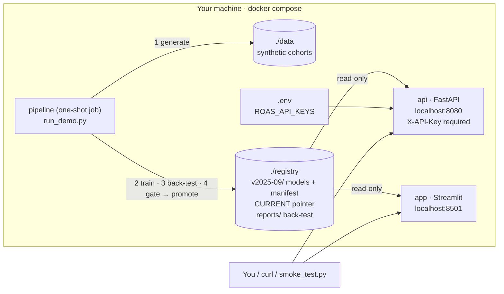

# v2: ROAS Forecasting, local production-style sample

A runnable, production-style sample of the v1 platform that runs entirely on your machine using **synthetic data**.
It needs no cloud account and no client data. The review findings from v1 are fixed here, and each fix has a test.

## Local architecture



| Service | What it does | Port | Starts when |
|---|---|---|---|
| `pipeline` | Generates synthetic data, trains bad / expected / good quantile models per game, runs a walk-forward back-test (6 forecast origins, models re-trained at each), and promotes the version to `CURRENT` only if it beats the naive baseline | – | First; exits when done |
| `api` | Forecast API: `POST /v2/forecast` scores the requested cohort month, spend and channel mix and returns bands; `GET /health`; `POST /v2/admin/reload` | 8080 | After the pipeline succeeds |
| `app` | Analytics Suite: live model version, back-test accuracy vs baselines, scenario what-ifs | 8501 | After the pipeline succeeds |

| Component | Path |
|---|---|
| Package code (data, splits, models, forecast, back-test, registry) | `src/roas/` |
| API and app | `services/api/`, `services/app/` |
| Single image used by all three services | `docker/Dockerfile` |
| Stack definition | `docker-compose.yml` |
| One-command pipeline | `run_demo.py` |
| API checks | `scripts/smoke_test.py` |
| Tests | `tests/` |

Production-style choices:

- **Security:** an API key is required (constant-time check), and the API refuses to start without keys. Containers run as non-root, and ports are bound to `127.0.0.1` only.
- **Reliability:** health checks on both services, and the API and app wait for a successful pipeline run.
- **Model management:** a versioned registry with a manifest recording the data hash, settings and library versions, and an automated promotion gate.
- **Reproducibility:** the synthetic data and training are deterministic.

## Option A: Docker (recommended)

Requires **Docker Desktop** (macOS / Windows) or Docker Engine with the Compose plugin (Linux).

```bash
# 1. Get the code
git clone https://github.com/<owner>/roas-forecasting-showcase.git
cd roas-forecasting-showcase/v2

# 2. Configure the API key
cp .env.example .env                        # Windows PowerShell: Copy-Item .env.example .env

# 3. Build and start: pipeline runs first (~2-4 min), then the API and app start
docker compose up --build
```

When the logs show `PASSED - v2025-09 is now CURRENT` and the API reports healthy, open a second terminal in `v2/`:

```bash
# 4. Verify the API: health, auth, forecast, input validation
python scripts/smoke_test.py               # Python 3 only; no packages needed
```

Expected:

```
[PASS] health is open and reports a model version
[PASS] forecast without API key is rejected (401)
[PASS] forecast with API key returns 12 months with bands
[PASS] unknown channel is rejected (422)
```

5. Explore:
   - **API docs:** http://localhost:8080/docs (click *Authorize* and enter the key from `.env`)
   - **Analytics Suite:** http://localhost:8501 (Home → Back-test → Scenario)
   - **Models and reports:** `./registry/` (`CURRENT`, `v2025-09/manifest.json`, `reports/backtest_summary.csv`)

```bash
# 6. Stop (keeps ./data and ./registry); add -v and delete both folders for a clean slate
docker compose down
```

Call the API yourself:

```bash
curl -s -X POST localhost:8080/v2/forecast \
  -H "Content-Type: application/json" -H "X-API-Key: local-demo-key" \
  -d '{"scenarios":[{"game_id":"SG01","cohort_month":"2025-10","forecast_months":12,
        "channel_spends":{"MC_Google":90000,"MC_TicToc":40000,"MC_Organic":20000}}]}'
```

## Option B: Plain Python (no Docker)

Requires **Python 3.10–3.13**.

```bash
cd roas-forecasting-showcase/v2
python3 -m venv .venv
source .venv/bin/activate                   # Windows PowerShell: .venv\Scripts\Activate.ps1
python -m pip install --upgrade pip
pip install -e ".[api,app,xgboost,dev]"

python run_demo.py                          # data -> train -> back-test -> gate -> sample forecasts
pytest                                      # 31 tests
```

Then start the services, each in its own terminal with the venv active:

```bash
# macOS / Linux
ROAS_REGISTRY=registry ROAS_API_KEYS=local-demo-key uvicorn services.api.main:app --port 8080
ROAS_REGISTRY=registry ROAS_REPORTS=registry/reports streamlit run services/app/Home.py
python scripts/smoke_test.py
```

```powershell
# Windows PowerShell
$env:ROAS_REGISTRY="registry"; $env:ROAS_API_KEYS="local-demo-key"; uvicorn services.api.main:app --port 8080
$env:ROAS_REGISTRY="registry"; $env:ROAS_REPORTS="registry/reports"; streamlit run services/app/Home.py
python scripts/smoke_test.py
```

`make` shortcuts (`make up`, `make smoke`, `make down`, `make demo`, `make test`) are available where `make` is installed.

## Expected pipeline output

`run_demo.py` prints the back-test summary and must end with `PASSED - v2025-09 is now CURRENT`. Verified output
from `docker compose up --build` (XGBoost backend, versions pinned in `requirements-lock.txt`, Apple Silicon, Oct 2026):

```
 key    n  mae_model  mae_baseline  mae_last_cohort  skill_vs_baseline  skill_vs_last_cohort  band_coverage
 all 5160     0.0097        0.0123           0.0139             0.2086                0.3014         0.5502
 1-3 1512     0.0121        0.0133           0.0142             0.0900                0.1468         0.4034
 4-6 1836     0.0100        0.0134           0.0148             0.2538                0.3243         0.5833
7-12 1812     0.0074        0.0102           0.0127             0.2782                0.4193         0.6391
```

Reading the table:

- **`mae_model`:** the v2 model's mean absolute error on monthly ROAS.
- **`mae_baseline`:** error of a naive baseline, the average curve of the 3 most recent cohorts.
- **`mae_last_cohort`:** error of the v1 method, reusing the latest cohort's curve.
- **`skill_*`:** the improvement over each baseline (21% and 30% overall).
- **`band_coverage`:** the share of actual values that fall between the bad and good forecasts (target about 50%).

With `ROAS_BACKEND=sklearn` (set in `.env`, or in your shell for Option B), the overall row is `0.0092 / 0.0123 / 0.0139`,
with skill `0.2501 / 0.3380` and coverage `0.5963`. The synthetic data is identical on every machine; small
differences in the last digits can come from CPU architecture.

## Troubleshooting

| Symptom | Fix |
|---|---|
| `set ROAS_API_KEYS in .env` | Run `cp .env.example .env` in `v2/` |
| API or app never start | The pipeline failed or the gate failed: `docker compose logs pipeline` |
| Port 8080 or 8501 already in use | Stop the other process, or change the left-hand port in `docker-compose.yml` |
| Permission denied writing `./data` or `./registry` (Linux) | `mkdir -p data registry && sudo chown 1000:1000 data registry` (containers run as uid 1000) |
| `ModuleNotFoundError: roas` (Option B) | Activate the venv and run `pip install -e .` inside `v2/` |
| Want a clean re-run | `docker compose down`, then delete `./data` and `./registry` |
